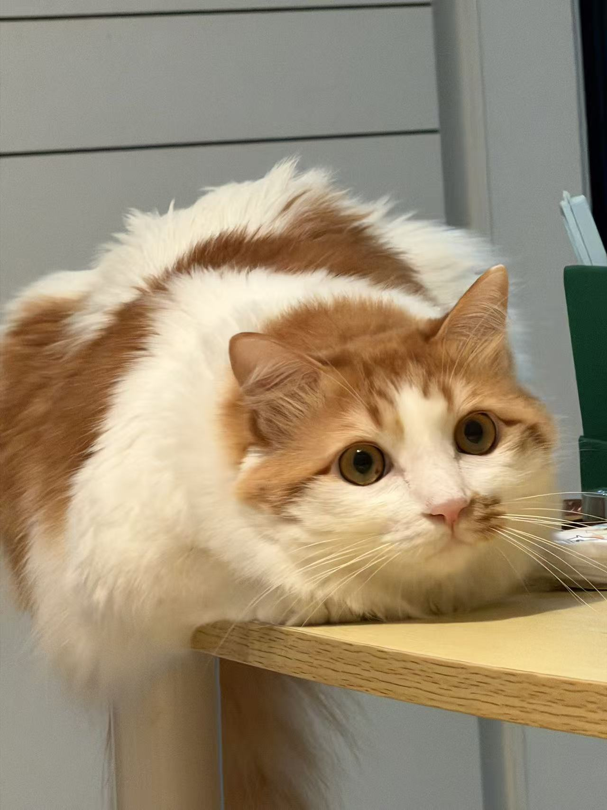
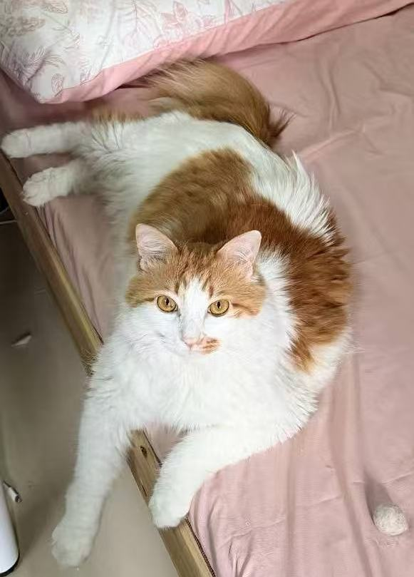
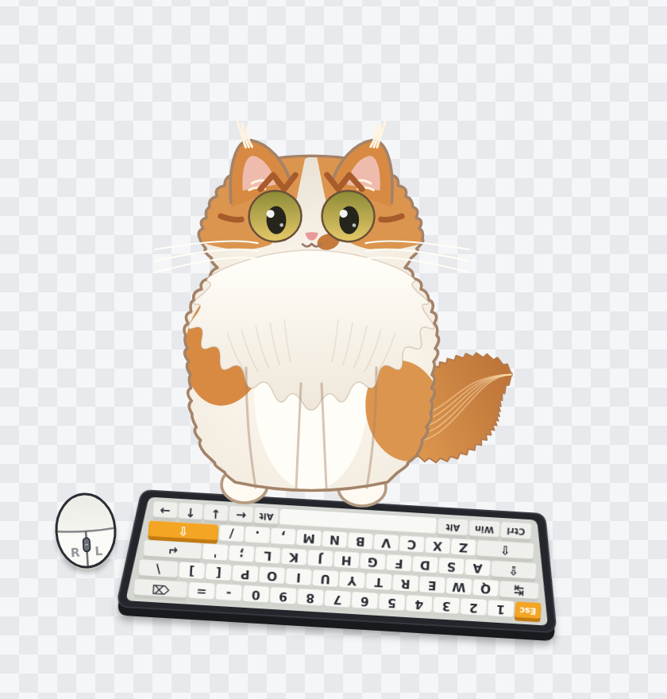
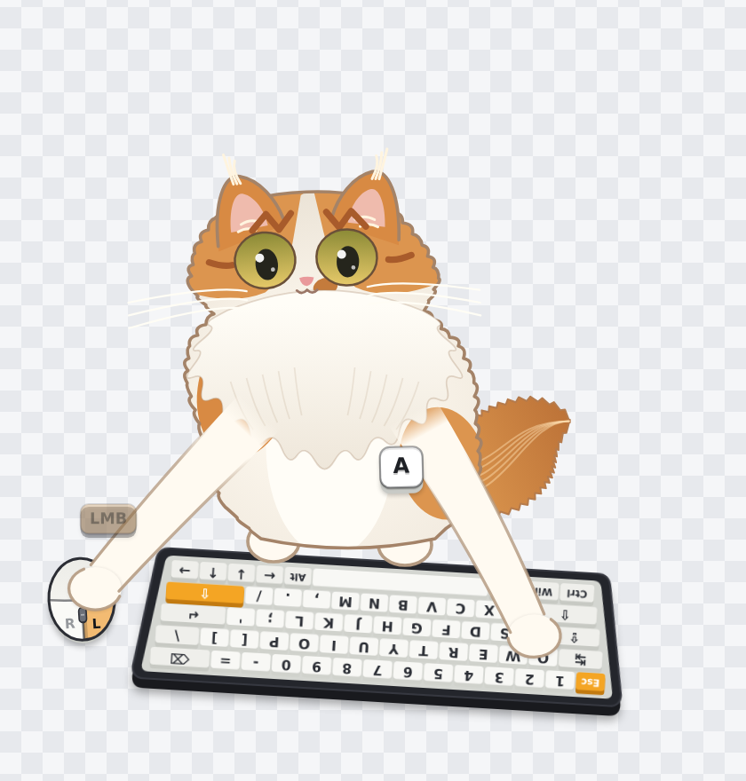

DEV-154：长毛橘白猫皮肤交接（未完成，草稿 PR）

按用户最新要求停止实现与构建，仅提交现有工作，交由其他机器接手。当前没有本任务遗留的编译或浏览器验证进程。

原始参考照片（用户提供，保留原始文件字节，未裁切、未重新压缩）：



面部特写用于核对窄白鼻梁、粉鼻、额头深橘 M 纹、圆黄绿/琥珀眼睛、橘色双颊、耳尖簇毛和超长白胡须。尤其保留猫左侧嘴角/鼻边的小橘斑，即观察者右侧的鼻旁橘斑。



全身照片用于核对蓬松长毛、厚白胸毛领、白色底毛上的大块橘色背斑、白色长毛四肢和粗大的橘色蓬松尾巴，不能简化成纯橘猫。

这两张是原始外观参考；应用形象仍采用 Canvas 程序绘制。文末预览为中间版本效果，接手时需继续对照原照片细化。

现有结构与实现：

- 普通猫由 `src/catEngine.ts` 使用 Canvas 连续绘制，逻辑尺寸为 420×440（65 键）或 540×456（108 键），按设备像素比渲染透明画布。普通猫没有贴图帧表；大肥鱼例外，使用 `src/assets/dafeiyu` 的透明 PNG 表情与独立渲染器。
- 新皮肤采用程序绘制，`src/assets/orange-white-longhair/skin.json` 作为 TypeScript 与 Rust 共用的注册数据。桌面菜单、独立菜单、网页试玩与 OBS 均接入；保存 3D 偏好时，此皮肤仍使用 Canvas。
- `src/longhairCoat.ts` 实现长毛轮廓、白毛领与橘色粗尾；鼻旁橘斑位于猫左侧（观察者右侧），并配置窄白鼻梁、M 纹、黄绿眼睛、白爪和长胡须。最后一轮新增了圆额头、毛流与程序生成的毛领缓存。
- 沿用原有弹簧、骨骼、眼神、键鼠、隐私闭眼与摆尾逻辑。此皮肤在待机时也持续刷新（目标 60 FPS；游戏节能模式保留 30 FPS）。其 CPU/功耗取舍仍需接手机器评估。

实际验证与边界：

- 较早版本 `npm run build`、`npm run build:web` 通过。最后一轮毛流与圆额头细化后发起的完整前端构建未取得完成结果，因此不能视为最终 HEAD 已通过构建。
- 阴影优化后的浏览器验证通过：选择并重启、保留 3D 偏好、透明像素、画布边缘无裁切、鼠标与键盘同时操作、隐私闭眼、108 键布局及 OBS。高分屏下待机采样 1.8 秒记录 107 帧，中位间隔 16.7 ms、P95 19 ms。对应验证脚本为 `npm run test:longhair`。
- 上述浏览器验证早于最后一轮毛流细化；附图也是该中间版本，不能代替最终版本验收。
- 原生 `npm run tauri -- build --debug --no-bundle` 在 GTK / tauri-utils 依赖编译期间占用过多资源，未完成。未验证原生窗口透明合成与置顶；不能宣称桌面构建/运行通过。
- 本轮遵照用户要求不再运行构建或测试。接手后优先静态检查最后一轮改动，再在有足够资源的机器完成前端与原生验证；原生编译建议先限制 Cargo 并行度与调试信息。

接手命令（请在其他机器执行）：

```sh
git fetch origin
git switch --track origin/feat/dev154-orange-white-cat
npm ci
npx playwright install chromium
npm run build
npm run build:web
npm run test:longhair
# 原生构建资源需求较高，按机器容量调整；本机不再执行。
CARGO_BUILD_JOBS=1 CARGO_PROFILE_DEV_DEBUG=0 npm run tauri -- build --debug --no-bundle
```

中间版本预览（非最终验收截图）：




