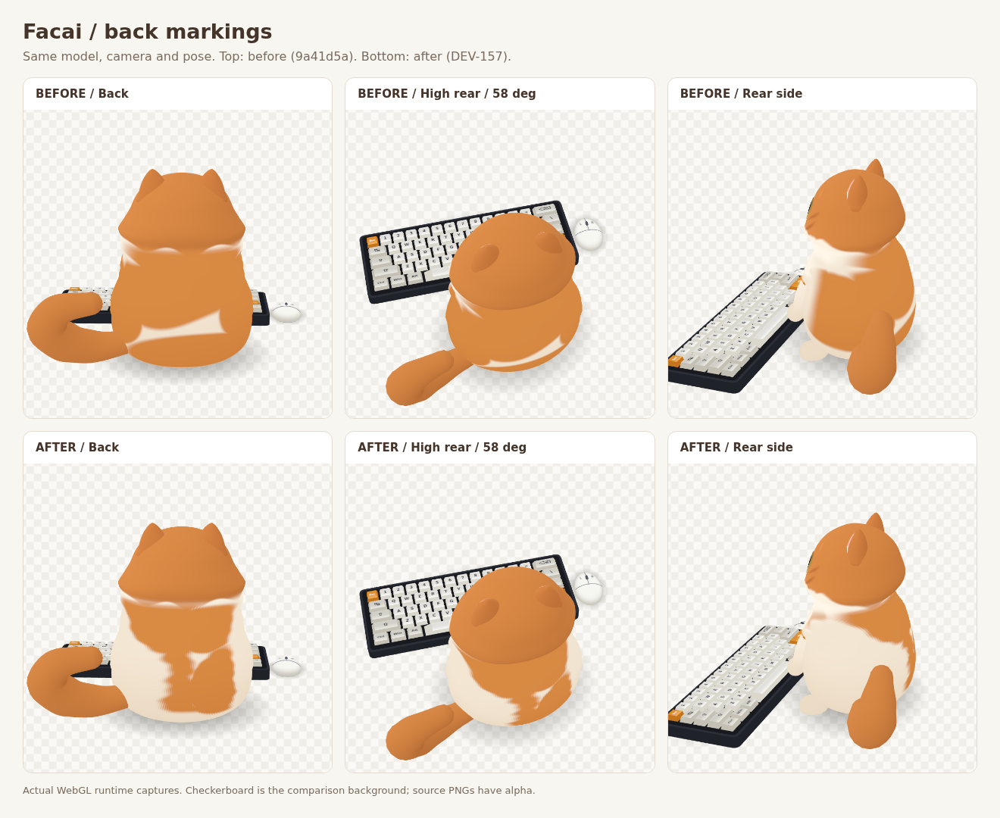
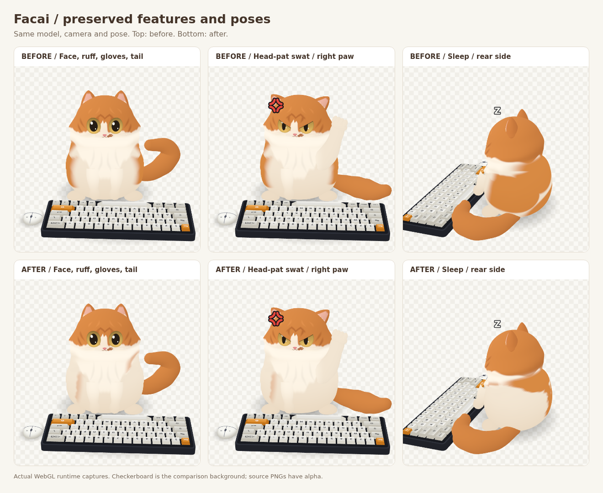
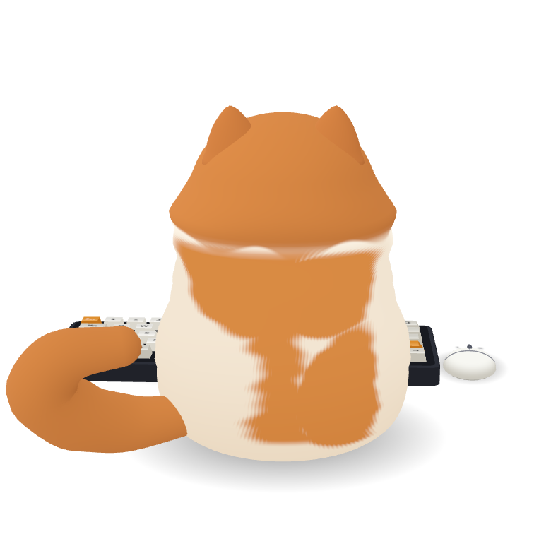

# 发财背部花纹修正（DEV-157）

结合本任务的正背与侧后两张实拍图，将发财原有的宽鞍斑、两侧橘斑和臀部橘斑，改为白底上的中央狭长橘斑、不对称肩背橘区与后侧橘区。尾巴从根部起保持橘色。

现有发财是实时 3D 皮肤：`src/longhair3d.ts` 生成模型和材质，DEV-156 的挥爪也是同一模型的实时动作，没有独立的逐帧 PNG 或 2D 挥爪素材。本次直接修正共用的背部材质，所有朝向、呼吸、低头、入睡和左右挥爪都使用该花纹。

## 修改前后

上排是主干提交 `9a41d5af12f1b65a55f827aebf8c7f3693716dde`，下排是本次修改。相机、动画时间、随机数和画面尺寸相同；所有画面均为实际 WebGL 运行截图。



| 部位 | 原素材与实拍的差异 | 本次修正 |
| --- | --- | --- |
| 肩颈、上背 | 鞍斑与侧斑连成大面积橘色，缺少与白色体侧的区分 | 正背左上的肩背橘区绕到正右上，与中央长斑衔接 |
| 背部中段 | 横向鞍斑过宽，缺少正背参考图的中央长斑 | 正背和俯视保留狭长、略弯曲的中央橘斑 |
| 体侧、髋部、臀部 | 两侧和臀部有大面积橘色 | 正背右下的后侧橘斑绕到正左下，另一侧体侧和臀部保持白色 |
| 斑块边缘 | 多个规则椭圆叠加，边界较平滑、色块感明显 | 多尺度起伏、顺毛流的细丝和柔化过渡 |



白鼻梁条、鼻旁橘斑、白毛领中央、白手套和全橘尾巴继续使用原有造型和配色。背部花纹沿身体两侧对角延伸，使正面右上和左下各露出一块橘色。正面截图的面部/鼻斑、白毛领、白手套和橘尾巴取样区域由比较脚本自动验证；运行检查另会断言正右上、正左下、尾根与尾巴主体均有橘色。

## 验证与复现

```sh
npm ci
npm run build
npm run build:facai
npm run test:swat
npm run test:swat:browser
npm run test:back-markings
```

浏览器脚本使用 Playwright Chromium；可设置 `PLAYWRIGHT_CHROMIUM_EXECUTABLE_PATH` 指向本机 Chromium。`test:back-markings` 自行启动并关闭 1457 端口的 Vite，输出到已忽略的 `artifacts/back-markings/after/`。

低内存环境应逐条执行这些命令，避免浏览器采集与原生 Rust 全量编译并行。可用 `NODE_OPTIONS=--max-old-space-size=384` 限制 Node 堆；采集脚本使用单个浏览器，切换动作前释放上一模型的 GPU 资源，直接保存 WebGL 画布。

- 6 个固定视角、左右挥爪各 25 帧、左右挥爪正面各 1 帧、入睡过渡 30 帧和入睡侧面，共 89 张透明 PNG。
- 每张检查 WebGL alpha、透明背景与可见的宠物像素，并捕获浏览器和 GLSL 错误。
- 在实际背部网格上定位后读取 11 个 GPU 像素：肩部左/中/右、上背中点、脊柱中下段、左体侧和左髋应为橘色；右体侧、右髋和臀部应为白色。
- 正面右上与左下取样区域各必须保留超过 10 个橘色像素；尾根必须有橘色像素，尾巴主体必须保留超过 1,000 个橘色像素。
- 原有挥爪单元测试及浏览器交互检查覆盖概率、左右选爪、肉垫/爪尖、抓痕、隐私中断、选键和动作结束后的恢复。

重新生成修改前截图时，Vite 只在内存中加载指定提交的原材质，不修改当前工作区：

```sh
npm run test:back-markings -- --record-before --source-ref 9a41d5af12f1b65a55f827aebf8c7f3693716dde --output artifacts/back-markings/before
npm run test:back-markings
node scripts/render-back-markings-comparison.mjs
```

最后一条命令检查保留特征的像素差异，并将两张对比图和一张原始透明截图写入本目录。对比图中的棋盘格仅用于展示透明背景，运行素材中不包含棋盘格。



`src-tauri/tauri.conf.json` 中的 `transparent: true` 与 `alwaysOnTop: true` 未改动。透明渲染已在 Linux Chromium/SwiftShader 中实际检查；Windows/macOS 的桌面窗口置顶和系统合成效果需要在对应系统实测。

本次原生 Rust 检查中断，未计入通过的验证；恢复后仅串行执行前端构建与浏览器检查。
