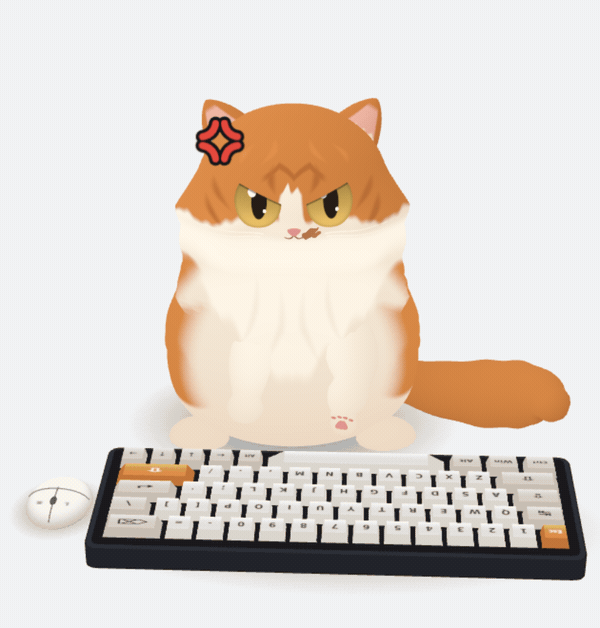

# 发财 3D：生气挥爪（DEV-156）

在猫咪头部来回抚摸，默认有 25% 概率生气并伸爪挥一下。右键菜单「摸头挥爪概率」可选关闭、25%、50%、100%；MCP `update_settings` 和 `settings.json` 的 `headPatSwatChance` 支持任意 0～1 数值。旧配置默认 0.25。



## 表情与前爪

动作播放 780ms，依次抬爪、掌心朝向观众、横挥、收爪。举爪时露出白手套中的粉色掌垫和四个趾垫，全部为有厚度的 3D 网格，使用项目已有的立体着色器；角色身体、鼻旁橘斑、白鼻梁、白毛领与橘色大尾巴继续由原长毛模型绘制。

生气表情在抬爪初段快速出现，并覆盖挥爪阶段：眼睑向鼻梁压低、瞳孔收紧、双耳折成飞机耳，头侧出现怒气符号。动作结束后眼睛、怒气符号及肉垫收回，不写入长期生气状态；隐私模式可立即中断。挥爪时暂停普通眯眼呼噜及好奇表情。

## 仅提供 3D 发财

发财专版和标准版中的发财皮肤均强制使用 3D。外观菜单隐藏 2D 切换，旧的 `renderMode: "2d"` 配置按 3D 加载，设置更新、MCP 切换角色、OBS 查询参数也遵循同一限制。图形加速不可用时显示提示，发财不会回退成 2D。标准版其他角色保留原有 2D 功能。

尾巴选键期间保持 3D，使用实际 3D 键帽射线检测，支持 65%／108 键布局，并阻止选键时误触挥爪。左键原生拖窗行为保留。

## 交互实现

桌面端通过 `kuro-cursor` 将归一化光标位置与粗略 `overCat` 判定传给渲染器。`src/catEngine3d.ts` 将桌面和网页两条指针路径都细化到真实头部射线检测。

`src/headPatSwat.ts` 负责手势、抽签冷却、前爪关键姿势与生气表情包络。至少两次 14 逻辑像素的反向移动才是有效抚摸；过滤静止悬停、抖动、单次路过及瞬移。每次抽签后冷却 3 秒，普通反应也占用冷却，避免连续移动反复抽签。鼠标／按键按住、隐私模式、尾巴选键期间不启动新动作。

`src/longhair3d.ts` 的眼睛材质接收生气程度，切出斜上眼睑并收紧瞳孔；现有耳朵与怒气特效使用同一表情程度。3D 白手套、掌垫和趾垫随右前爪移动，举爪时将掌心转向观众。没有独立的 2D 挥爪素材。

## 验证与复现

```bash
npm ci
npm run test:swat
npx playwright install chromium
npm run test:swat:browser
npm run build
npm run build:facai
cargo test --locked --manifest-path src-tauri/Cargo.toml
cargo test --locked --manifest-path src-tauri/Cargo.toml --features facai-only --lib
cargo build --locked --manifest-path src-tauri/Cargo.toml
```

可用 `PLAYWRIGHT_CHROMIUM_EXECUTABLE_PATH` 指定已安装的 Chromium。浏览器检查自行启动并停止 1456 端口的 Vite；加 `-- --capture` 将 30 帧透明 3D PNG 写入已忽略的 `artifacts/head-pat-swat/`。预览以 100% 概率触发，再按固定时间采样；概率边界由单元测试验证。

验证覆盖概率、冷却、手势过滤、表情出现与恢复、肉垫可见且朝向观众、隐私中断、旧 2D 配置、主窗口与菜单、无图形加速时不回退 2D、3D 尾巴选键及 65%／108 键帽射线。原生窗口透明／置顶的验证范围见 PR；Windows／macOS 尚未实机复验。
