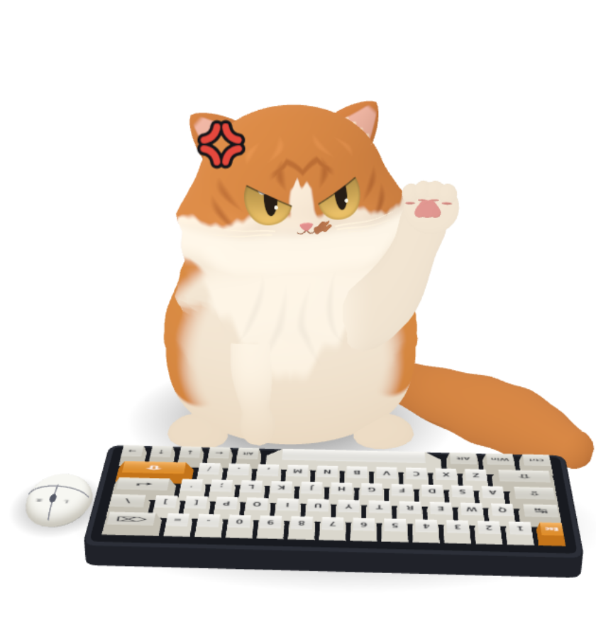
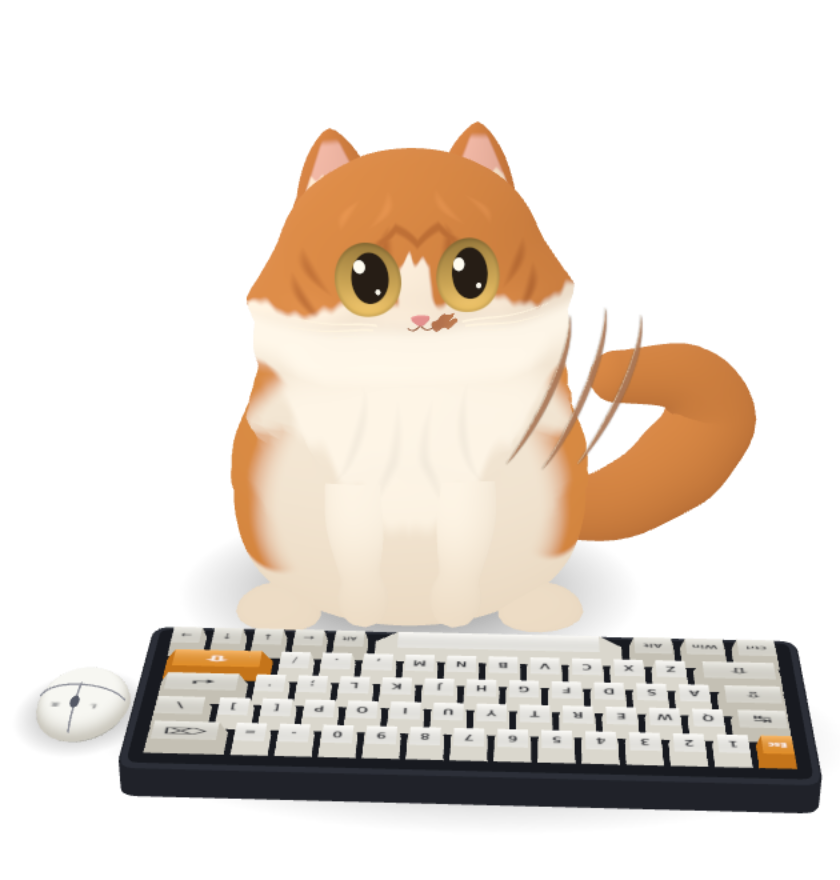

# 发财 3D：生气半握爪与屏幕抓痕（DEV-156）

在猫咪头部来回抚摸，默认有 25% 概率生气并伸爪挥一下。右键菜单「摸头挥爪概率」可选关闭、25%、50%、100%；MCP `update_settings` 和 `settings.json` 的 `headPatSwatChance` 支持任意 0～1 数值。旧配置默认 0.25。


## 表情与前爪

动作播放 780ms，依次半握抬爪、蓄力、朝屏幕伸爪并向下划、收爪。四个趾头并拢向掌心卷起，发力时进一步收紧；举爪阶段仍能看到掌垫和卷起的趾垫，接触时短暂伸出小爪尖。

前爪由长毛模型直接管理，与原有前腿共用同一个奶油色哑光材质和柔和光照，腕部连续衔接。肉垫改为浅浮雕的三叶掌垫和薄趾垫，颜色由皮肤的鼻头暖粉色与爪部轮廓色调和，使用鼻头同一套雕塑着色器。前爪缩小并压低趾头的圆鼓程度，避免过亮的白手套和糖果质感。角色身体、鼻旁橘斑、白鼻梁、白毛领与橘色大尾巴继续由原长毛模型绘制。

生气表情在抬爪初段快速出现，并覆盖挥爪阶段：眼睑向鼻梁压低、瞳孔收紧、双耳折成飞机耳，头侧出现怒气符号。动作结束后眼睛、怒气符号及肉垫收回，不写入长期生气状态；隐私模式可立即中断。挥爪时暂停普通眯眼呼噜及好奇表情。



## 屏幕抓痕

伸爪接触点约在第 406ms，每次动作只产生一组三道细长抓痕。抓痕从爪尖接触处向左下方逐渐划出，约 130ms 完成，与向下划的腕部动作衔接。细痕两端收尖，使用暖褐色凹线和象牙色细边，在浅色、深色桌面上均可辨认。

抓痕留在桌宠透明窗口内的屏幕落点，收爪或转动视角不会带走它。先停留再淡出，约 1.65 秒清除，不增加鼠标捕获区域。效果使用透明纹理和相机空间精灵覆盖在角色前方；隐私模式、换肤、停止渲染和进入尾巴选键都会立即清除抓痕，并取消尚未发生的接触事件。



## 仅提供 3D 发财

发财专版和标准版中的发财皮肤均强制使用 3D。外观菜单隐藏 2D 切换，旧的 `renderMode: "2d"` 配置按 3D 加载，设置更新、MCP 切换角色、OBS 查询参数也遵循同一限制。图形加速不可用时显示提示，发财不会回退成 2D。标准版其他角色保留原有 2D 功能。

尾巴选键期间保持 3D，使用实际 3D 键帽射线检测，支持 65%／108 键布局，并阻止选键时误触挥爪。左键原生拖窗行为保留。

## 交互实现

桌面端通过 `kuro-cursor` 将归一化光标位置与粗略 `overCat` 判定传给渲染器。`src/catEngine3d.ts` 将桌面和网页两条指针路径都细化到真实头部射线检测。

`src/headPatSwat.ts` 负责手势、抽签冷却、前爪姿势／握拳程度、生气表情包络及一次性的接触事件。至少两次 14 逻辑像素的反向移动才是有效抚摸；过滤静止悬停、抖动、单次路过及瞬移。每次抽签后冷却 3 秒，普通反应也占用冷却，避免连续移动反复抽签。鼠标／按键按住、隐私模式、尾巴选键期间不启动新动作。

`src/longhair3d.ts` 的眼睛材质接收生气程度，切出斜上眼睑并收紧瞳孔；现有耳朵与怒气特效使用同一表情程度。该模型还负责半握爪、肉垫及爪尖的造型、材质与卷曲。`src/catEngine3d.ts` 驱动动作并将爪尖接触点传给 `src/screenClawScratches3d.ts`，后者负责三道抓痕的渐进绘制、屏幕定位及淡出。没有独立的 2D 挥爪素材。

## 验证与复现

```bash
npm ci
npm run test:swat
npx playwright install chromium
npm run test:swat:browser
npm run build
npm run build:facai
cargo test --locked --manifest-path src-tauri/Cargo.toml
cargo test --locked --manifest-path src-tauri/Cargo.toml --features facai-only --lib
cargo build --locked --manifest-path src-tauri/Cargo.toml
```

可用 `PLAYWRIGHT_CHROMIUM_EXECUTABLE_PATH` 指定已安装的 Chromium。浏览器检查自行启动并停止 1456 端口的 Vite；加 `-- --capture` 将 80 帧透明 3D PNG 写入已忽略的 `artifacts/head-pat-swat/`。预览以 100% 概率触发，再按每帧 32ms 连续推进，包含抬手、伸爪、下划、收爪和抓痕完整淡出；概率边界由单元测试验证。

文档中的两张 PNG 均为 840×880 RGBA 透明截图；GIF 为 600×628、约 2.52 秒，使用浅灰背景展示抓痕淡出。预览来自实际 3D 渲染器。

验证覆盖概率、冷却、手势过滤、半握爪在接触时收紧、表情出现与恢复、举爪肉垫可见、前腿材质共用、肉垫配色及浅浮雕、爪尖伸缩、单次接触事件、三道细抓痕的形状及固定／持续／淡出／清除、隐私中断、旧 2D 配置、主窗口与菜单、无图形加速时不回退 2D、3D 尾巴选键及 65%／108 键帽射线。原生窗口透明／置顶的验证范围见 PR；Windows／macOS 尚未实机复验。
